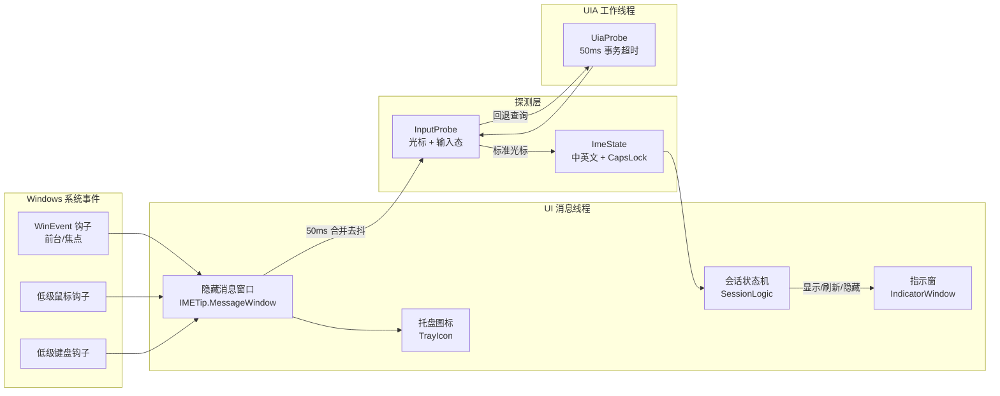
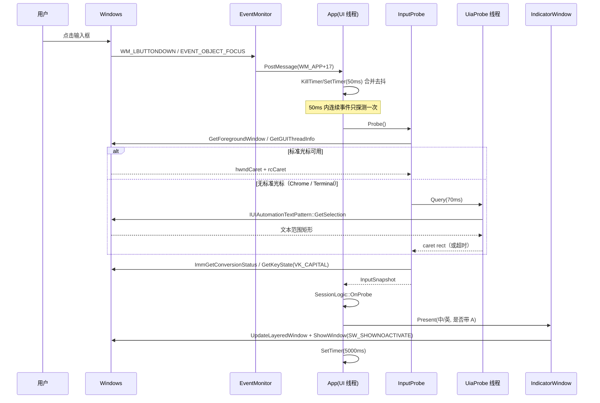
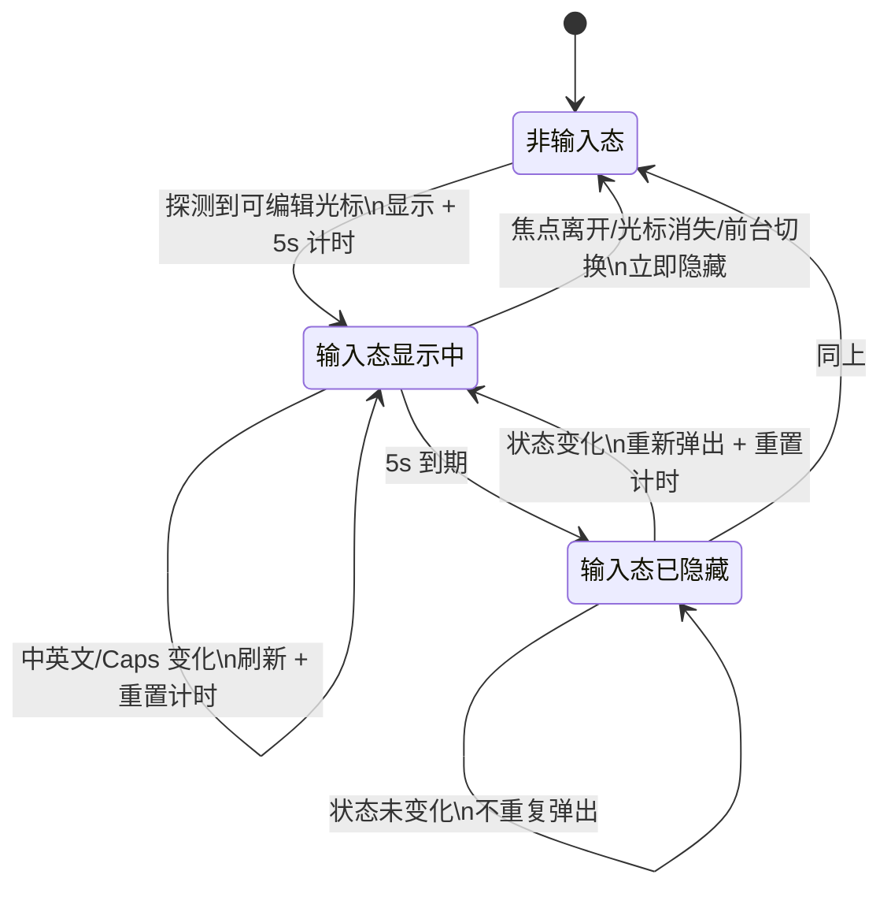

# 架构设计

## 1. 总览

IMETip 是一个单进程、双线程的 Win32 原生程序：一个 UI/消息线程负责全部系统交互与绘制，一个 UI Automation 工作线程专职处理可能阻塞的跨进程查询。

## 2. 模块划分

| 目录 | 模块 | 职责 |
| --- | --- | --- |
| `src/app` | `App` | 装配各模块、隐藏消息窗口、定时器、托盘菜单、命令行、生命周期 |
| `src/app` | `Config` | `%LOCALAPPDATA%\IMETip\config.ini` 读写与取值收敛 |
| `src/core` | `EventMonitor` | `SetWinEventHook`（前台 / 焦点 / 开始滚动）+ 低级鼠标 / 键盘钩子，只投递“发生了什么”，不做事 |
| `src/core` | `InputProbe` | 判定输入态、取光标矩形、组装一次探测快照 |
| `src/core` | `ImeState` | `ImmGetConversionStatus` + 语言掩码判断中英文 |
| `src/core` | `SessionLogic` | 纯逻辑输入态会话状态机（可单测） |
| `src/platform` | `UiaProbe` | 独立线程的 UI Automation 文本光标查询，带超时 |
| `src/platform` | `Dpi` / `Autostart` | 显示器 DPI、开机自启注册表 |
| `src/ui` | `IndicatorWindow` | 分层透明窗口、定位、淡出、消息处理 |
| `src/ui` | `IndicatorRenderer` | 纯绘制：圆角渐变、字形、阴影（可被工具复用） |
| `src/ui` | `IndicatorLayout` | 纯整数定位算法：右上优先、越界翻转、工作区收敛（可单测） |
| `src/ui` | `TrayIcon` / `AppIcon` | 托盘图标与运行时多尺寸图标生成 |
| `src/util` | `Log` | 可选诊断日志，默认关闭 |

模块之间只通过值结构体（`InputSnapshot`、`IndicatorState`、`SessionDecision`）传递数据，UI 渲染不依赖 Win32 窗口状态，核心判定不依赖 UI。

## 3. 线程模型

| 线程 | 内容 | 阻塞风险 |
| --- | --- | --- |
| UI 线程 | 消息循环、钩子回调、`GetGUIThreadInfo`、IME 查询、GDI+ 绘制、托盘 | 低。跨进程调用只有 `GetGUIThreadInfo` / `ImmGetContext`，均为快速调用 |
| UIA 线程 | `IUIAutomation` 单例 + 串行请求队列 | 高。可能遇到无响应应用，因此设置 50 ms 事务超时，UI 线程最多等 70 ms 后放弃本次判定 |

`UiaProbe::Query` 采用“请求序号 + 条件变量”模型：UI 线程发出请求后等待结果，超时直接返回空结果；迟到的结果因序号不匹配而被丢弃，不会污染下一次查询。同一时刻只允许一个未完成请求，避免堆积。

## 4. 事件驱动链路

### 为什么不是轮询

PRD 明确禁止定时轮询检测输入态。这里的定时器只有三种用途，都不参与“检测”：

1. **50 ms 合并去抖**：把同一动作产生的多个事件（鼠标按下、焦点变化、捕获变化）合并为一次探测，减少 IME 查询次数，避免干扰候选词。
2. **5 秒显示计时**：纯 UI 计时，到期隐藏指示窗。
3. **200ms / 600ms 两次一次性复查**：点击/焦点首次探测未命中时补查，应对目标应用异步创建光标（微信 Qt 输入框）与 UIA 提供程序首次加载的耗时，每次点击最多触发两次。

探测本身只在系统事件到达时发生。若钩子注册失败，程序不会退化为轮询，而是通过托盘气泡提示用户（`FR-01` / `FR-08`）。

### 滚动即隐藏

窗口滚动会使光标相对内容的位置失效，因此监听到以下事件时立即隐藏指示窗（不等待 5 秒计时），但**保留会话**：滚动后继续输入或切换中英文，仍可正常刷新/重新弹出。

| 来源 | 事件 |
| --- | --- |
| WinEvent | `EVENT_SYSTEM_SCROLLINGSTART`（滚轮、拖动滚动条、代码滚动） |
| 鼠标钩子 | `WM_MOUSEWHEEL` |
| 键盘钩子 | `PageUp` / `PageDown` |

## 5. 会话状态机

`SessionLogic` 是纯逻辑实现，不依赖 Win32，单元测试覆盖全部迁移。

要点：

- **会话标识**：使用焦点控件 HWND 作为 `focusKey`。同一控件内状态不变时，即使再次点击也不重复弹出；焦点切换到另一个输入控件则视为新会话，重新显示一次。
- **大写条件显示**：`IndicatorState.capsLock` 参与“是否变化”的判断，但渲染层只在大写时追加「A」。因此“大写 → 小写”会触发一次刷新（移除 A 并重置计时），符合 `FR-04`。
- **隐藏不结束会话**：5 秒到期只把 `visible` 置 false，会话仍然有效，状态变化可以重新弹出。

## 6. 指示窗渲染与定位

### 定位

`ComputePlacement` 为纯整数算法，默认**与光标同一水平线**：

1. 内容块垂直中心对齐光标垂直中心：`innerY = caret.top + (caretHeight - blockHeight) / 2`，水平放在光标右侧 `caret.right + offsetX`。
2. 右侧越界 → 翻转到光标左侧（`caret.left - offsetX - width`），垂直仍然对齐光标中线。
3. 上下越界 → 贴住工作区边界收敛（不翻到另一行，避免提示窗跑到离光标很远的地方）。
4. 最后把含阴影的窗口矩形整体收敛到显示器工作区，保证完整可见。

窗口尺寸随色块数量自适应（1 块或 2 块），不预留固定空位，避免出现“透明空洞”。

### 渲染

- 使用 32bpp **预乘 alpha** 的 DIB 作为画布，GDI+ 直接绘制到该内存（`Bitmap(w,h,stride,PixelFormat32bppPARGB,bits)`），再用 `UpdateLayeredWindow(ULW_ALPHA)` 呈现，避免直通 alpha 造成的边缘发白。
- 色块：垂直线性渐变 + 1px 内描边 + 圆角 8px（96 DPI）。
- 阴影：先按整体轮廓做裁剪排除，只在轮廓外绘制多层低透明度圆角矩形，因此**色块之间的间隙不会被阴影填成灰带**。
- 淡出：逐帧重绘并按比例缩放预乘像素（12 帧 × 16 ms ≈ 200 ms），默认关闭。

### 层级与交互

`WS_EX_LAYERED | WS_EX_TRANSPARENT | WS_EX_TOPMOST | WS_EX_TOOLWINDOW | WS_EX_NOACTIVATE`：

| 样式 | 作用 |
| --- | --- |
| `LAYERED` | 逐像素 alpha |
| `TRANSPARENT` | 鼠标点击穿透到下层应用 |
| `TOPMOST` | 始终可见 |
| `TOOLWINDOW` | 不出现在任务栏和 Alt+Tab |
| `NOACTIVATE` | 不抢键盘焦点 |

窗口过程额外返回 `HTTRANSPARENT` / `MA_NOACTIVATE` 作为双保险。

## 7. 失败与降级

| 场景 | 行为 |
| --- | --- |
| 标准光标不可用 | 回退 UIA 文本光标 |
| 两者都不可用，但有该窗口类的位置记忆 | 用记住的输入框位置显示（标记「记忆位置」） |
| 两者都不可用且没有位置记忆 | 不显示指示窗，不影响目标应用；可在托盘菜单校准 |
| UIA 超时 / 失败 | 不显示指示窗，不影响目标应用（本次探测视为非输入态） |
| IME 查询失败 | 沿用上次有效状态，不弹窗、不崩溃 |
| 非中文键盘布局 | 直接判定英文，不查询 IME |
| 钩子注册失败 | 托盘气泡提示“运行受限”，不改为轮询 |
| 资源管理器重启 | 收到 `TaskbarCreated` 后重新 `NIM_ADD` |
| 系统注销 / 关机 | `WM_ENDSESSION` 中先 `NIM_DELETE`，避免幽灵图标 |

### 无光标窗口的位置记忆

少数程序（实测：微信 4 的 Qt 输入框）既没有 `GUIThreadInfo` 光标，也没有 UIA 文本接口，切换会话时也不产生任何可用 WinEvent。这类窗口无法“探测”位置，只能“记住”位置：

1. **学习**：任意一次拿到真实光标（例如双击输入框让它产生光标），或用户从托盘菜单指定一次；记录光标相对窗口左上角的偏移、当时窗口尺寸。
2. **存储**：按窗口类名写入 `config.ini` 的 `[anchors]` 段（`类名=dx,dy,w,h`），最多 12 条。
3. **复用**：同一窗口类、尺寸偏差 15% 以内时视为同一布局，用记住的位置作为提示锚点。
4. **触发**：点击**输入框附近**或**窗口左侧列表区**视为进入输入框（切换聊天），即使状态没变也提示一次；点消息气泡等区域不提示，避免翻阅消息时反复弹出。

这条路径不注入任何进程，也不做轮询，代价是“第一次在某程序里要校准一次”。`anchorMode=0` 可关闭。

## 8. 资源占用

| 指标 | 实测（Windows 11 x64，Release） |
| --- | --- |
| 私有内存 | ≈ 3.9 MB |
| 工作集 | ≈ 20 MB（含共享系统 DLL） |
| 空闲 CPU | 0（无定时器、无轮询） |
| 可执行文件 | ≈ 262 KB（静态 CRT，单文件） |
| 冷启动到托盘可见 | < 200 ms |

## 9. 关键取舍

| 取舍 | 原因 |
| --- | --- |
| 用低级钩子感知点击 / 按键 | PRD 要求事件驱动且覆盖“点击非输入区域”；代价是被安全软件误报的概率略高，已在文档中说明 |
| 中英文状态：能读到就用真值，读不到按 Shift / Ctrl+Space 的切换动作推断 | 微信输入法（TSF）不向外部暴露状态，`ImmGetContext` 与 `WM_IME_CONTROL` 都返回固定值；推断是唯一不注入进程的做法 |
| 无光标窗口按窗口类记住输入框位置 | 这类窗口（微信）连 UIA 树都是空的，除了“记住上次位置”没有别的合法信号；用点击区域判定减少误弹 |
| 运行时不加载 PNG/ICO，直接用 GDI+ 画托盘图标 | 保证 16/20/24/32 px 各尺寸清晰，且暂停态只需换一套配色 |
| 大图（≥128 px）用 PNG 压缩写入 ICO | 控制资源体积（256 px 从 262 KB 降到 5 KB） |
| 只区分中文 / 非中文 | 产品定位为中英提示；日文、韩文输入法按英文态显示，见兼容性说明 |
